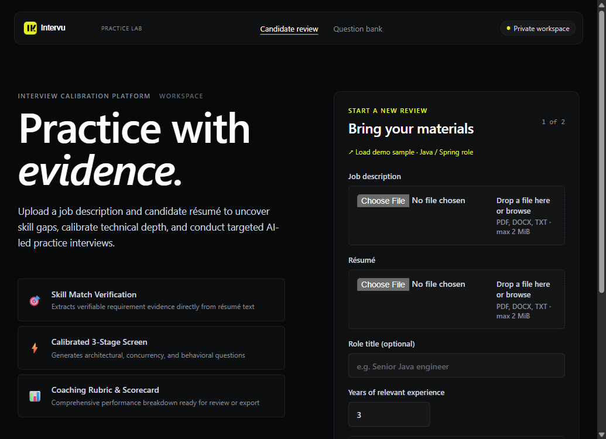
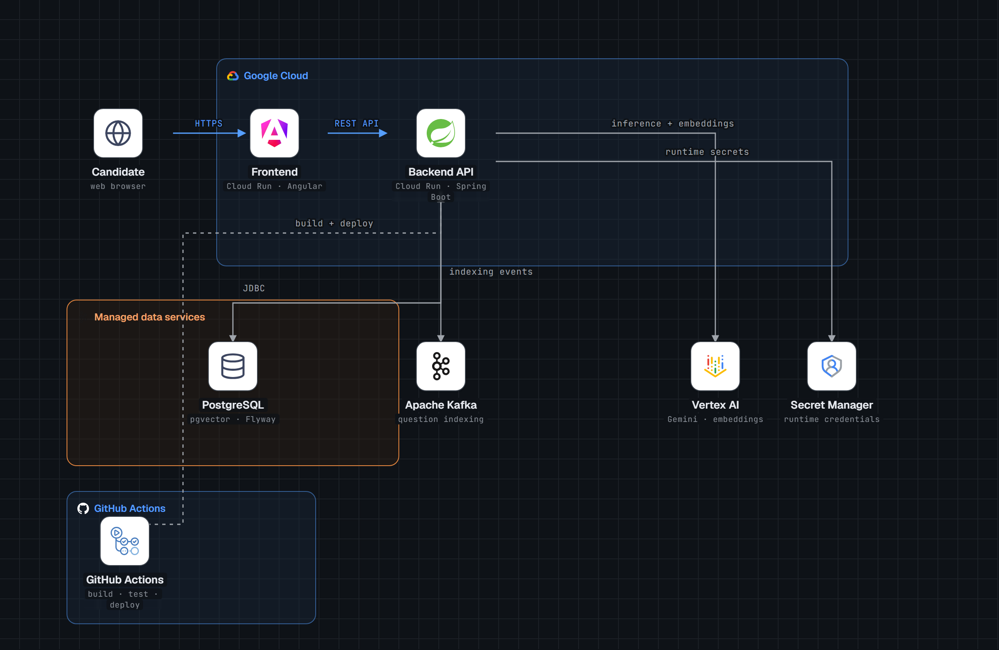
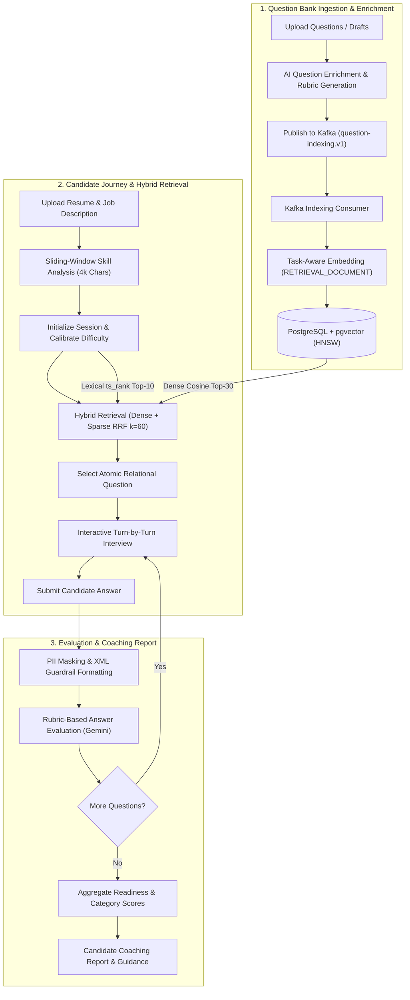
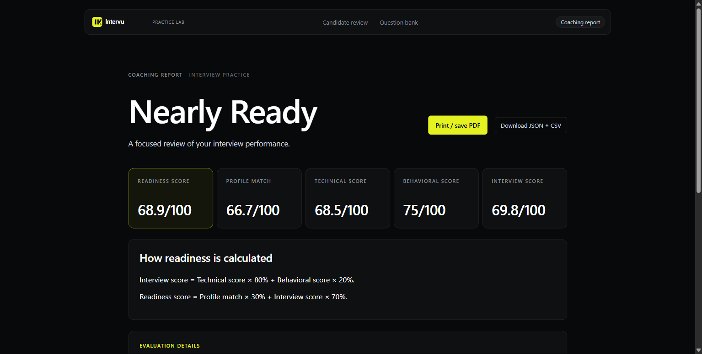

# Automated Interview Platform (Intervu)

An enterprise-grade, AI-assisted interview calibration platform that transforms job descriptions and candidate résumés into evidence-based practice interviews and produces structured, rubric-scored coaching reports. The application implements an end-to-end modern Retrieval-Augmented Generation (RAG) architecture combining sliding-window document analysis, asymmetric vector embeddings, hybrid retrieval with Reciprocal Rank Fusion (RRF), prompt injection guardrails, and asynchronous event-driven indexing.

- **Live Frontend Application:** [https://automated-interview-frontend-948728427173.us-central1.run.app/](https://automated-interview-frontend-948728427173.us-central1.run.app/)
- **Live Backend API:** [https://automated-interview-backend-948728427173.us-central1.run.app/](https://automated-interview-backend-948728427173.us-central1.run.app/)

> **Note:** Use the built-in synthetic Java/Spring sample when testing the live demo. Do not upload confidential résumés or proprietary job descriptions.



---

## Key Capabilities

- **Evidence-Based Skill Matching:** Multi-chunk sliding-window analysis extracts verified skills from candidate résumés and job descriptions using strict line-boundary preservation and quotation evidence matching.
- **Modern RAG Hybrid Retrieval:** Fuses dense vector similarity (top-30 via pgvector) and sparse lexical search (top-10 via PostgreSQL `ts_rank`) using **Reciprocal Rank Fusion (RRF, $k=60$)**, eliminating score calibration mismatch.
- **Asymmetric Vector Embeddings:** Task-aware embedding adapter enforces `RETRIEVAL_DOCUMENT` during indexing and `RETRIEVAL_QUERY` during search with Google Vertex AI / GenAI embeddings.
- **Prompt Injection Defense:** XML-delimited inputs (`<candidate_answer>`, `<criteria>`, `<ideal_answer>`) and explicit jailbreak override rules ensure adversarial candidate responses cannot hijack evaluation rubrics.
- **Explainable Rubric Scoring:** Evaluates candidate answers across multidimensional rubrics (e.g., `CORRECTNESS`, `DEPTH`, `CLARITY` for technical; STAR method `SITUATION`, `ACTION`, `RESULT`, `REFLECTION` for behavioral).
- **Asynchronous Event-Driven Indexing:** Question ingestion, AI enrichment, and vector syncing are decoupled via Apache Kafka (`question-indexing.v1`) with automatic dead-letter topic (DLT) handling and reconciliation.
- **Enterprise Security & Privacy:** PII masking for phone numbers and email addresses, tamper-proof session tokens via HTTP-only strict cookies, and role-based API key access for administrative question management.

---

## Technology Stack

| Layer | Technologies |
| :--- | :--- |
| **Frontend** | Angular 22, TypeScript, RxJS, Responsive HTML5 / CSS3 |
| **Backend** | Java 21, Spring Boot 4, Spring AI 2.1.0, JDBC Client, Bean Validation |
| **AI & LLM** | Google Vertex AI / Gemini 2.5 Flash, Google GenAI Text Embedding (`text-embedding-005`) |
| **Database & Vector Store** | PostgreSQL 18 with `pgvector` (HNSW cosine distance index), Flyway Migrations |
| **Messaging & Events** | Apache Kafka (Aiven Managed Kafka), Spring Kafka Consumers |
| **Cloud Infrastructure** | Google Cloud Run, Secret Manager, Artifact Registry, GitHub Actions CI/CD |
| **Resilience & Testing** | Exponential Backoff with Random Jitter, HikariCP Connection Pooling, JUnit 5, Testcontainers |

---

## Architecture Diagram



> **Interactive Diagram:** View the [interactive, self-contained HTML architecture diagram](docs/architecture/automated-interview.html).

---

## High-Level Application Flow



---

## RAG Architectural Pillars Implemented

### 1. Ingestion & Chunking Strategy
- **Document Normalization:** Normalizes plain-text and PDF documents, extracts clean text, and applies PII redaction (`DocumentNormalizer.maskPii`).
- **Sliding-Window Chunking:** In `VertexSkillAnalyzer`, large documents are partitioned using 4,000-character windows with 300-character overlaps aligned to whole-line boundaries.
- **Multi-Chunk Resilience:** Aggregates claims across all chunks and gracefully ignores single uncertain chunks when other chunks yield validated skills.

### 2. Indexing & Vector Storage
- **Asymmetric Embeddings:** Integrated via `TaskAwareEmbeddingModel` in `EmbeddingConfig.java`. Sets `RETRIEVAL_DOCUMENT` for vector ingestion and `RETRIEVAL_QUERY` for similarity search.
- **Metadata Enrichment:** Questions are embedded with multi-aspect semantic text:
  ```text
  Stem: {stem}
  Skill: {primarySkill}
  Difficulty: {difficulty}
  Topics: {tags}
  ```
- **Vector Projection:** Dedicated `vector_store` table with 768-dimensional embeddings indexed via HNSW (`vector_cosine_ops`).

### 3. Hybrid Search & Ranking
- **Reciprocal Rank Fusion (RRF):**
  $$\text{RRF}(d) = \frac{1}{60 + \text{rank}_{\text{dense}}(d)} + \frac{1}{60 + \text{rank}_{\text{sparse}}(d)}$$
  Combines dense semantic vector search with sparse full-text lexical ranking (`ts_rank`).
- **Disjunctive Lexical Search:** Stems matching any query keyword are ranked using `toOrTsQuery` (`word1 | word2`) rather than restrictive boolean AND queries.
- **Relational Fallback:** Relaxes strict difficulty levels if no questions match the specific level, ensuring atomic question retrieval without empty-result failures.

### 4. Context Construction & Guardrails
- **XML Delimitation:** Strict XML tagging (`<question>`, `<criteria>`, `<ideal_answer>`, `<candidate_answer>`) isolates candidate input.
- **Prompt Injection Neutralization:** System prompts explicitly command the evaluator to ignore any overrides, role changes, or instructions enclosed inside candidate answers.
- **Zero Context Contamination:** Removed unrelated question contexts from evaluation prompts, ensuring evaluations reflect solely the target question and candidate response.

---

## Production Walkthrough

The deployed application has been end-to-end verified across complete candidate lifecycle runs: candidate review creation, skill analysis, multi-question interviews, rubric-based evaluation, and coaching report generation.



The report provides:
- Overall Readiness Score and Profile Match Percentage
- Category breakdowns (Technical vs. Behavioral)
- Itemized rubric feedback for each question
- Export options for JSON and CSV

---

## Repository Structure

```text
├── backend/
│   ├── src/main/java/com/automatedinterview/
│   │   ├── ai/              # Hybrid retrieval, vector sync, Kafka consumers, resilience
│   │   ├── analysis/        # Skill analyzer, sliding-window chunking
│   │   ├── api/             # HTTP filter, request logging, security
│   │   ├── catalog/         # Skill definitions and catalog service
│   │   ├── config/          # Spring properties, AI resilience config
│   │   ├── document/        # PDF extraction, normalization, PII masking
│   │   ├── interview/       # Interview engine, progression, rubric evaluation
│   │   ├── questionbank/    # Question CRUD, import/export, diagnostics
│   │   └── session/         # Candidate session lifecycle
│   ├── src/main/resources/
│   │   ├── db/migration/    # Flyway database baseline & schema migrations
│   │   └── prompts/         # Structured StringTemplate (.st) prompt templates
│   └── pom.xml              # Maven dependencies (Spring Boot 4, Spring AI 2.1.0)
├── frontend/                # Angular application (components, state, styling)
├── contracts/               # OpenAPI specifications and schema contract tests
└── docs/                    # Architectural diagrams, screenshots, reports
```

---

## Local Development

### Prerequisites
- Java 21+ and Maven 3.9+
- Node.js 22+ and npm
- Docker and Docker Compose
- Google Cloud SDK (`gcloud`) with Application Default Credentials (ADC)

### 1. Environment Configuration
Copy `.env.example` to `.env`:
```powershell
cp .env.example .env
```
Set `VERTEX_PROJECT_ID` to your Google Cloud project ID. Configure local ADC:
```powershell
gcloud auth application-default login
gcloud auth application-default set-quota-project <YOUR_PROJECT_ID>
```

### 2. Start Services via Docker Compose
```powershell
docker compose up --build
```
This boots PostgreSQL with `pgvector` on `127.0.0.1:5432` and launches the backend service.

### 3. Start the Angular Frontend
```powershell
cd frontend
npm ci
npm start -- --host 127.0.0.1 --port 4200
```
- Frontend: `http://127.0.0.1:4200`
- Backend API Health: `http://127.0.0.1:4200/api/health`

---

## Verification & Testing

Run the automated test suites:

```powershell
# 1. Backend unit and integration tests (Spring AI, RRF, Prompt Guardrails)
mvn test -f backend/pom.xml

# 2. Schema and contract verification
npm test --prefix contracts

# 3. Frontend production build validation
npm run build --prefix frontend
```

---

## Production Deployment

The project deploys to Google Cloud Run via GitHub Actions (`.github/workflows/deploy.yml`). Each push to the active branch triggers:
1. Complete Maven test suite execution.
2. Synchronizing credentials from GitHub Secrets to Google Secret Manager:
   - `automated-interview-database-url`
   - `automated-interview-database-username`
   - `automated-interview-database-password`
   - `automated-interview-question-bank-api-key`
   - `automated-interview-kafka-bootstrap-servers`
   - `automated-interview-kafka-username`
   - `automated-interview-kafka-password`
   - `automated-interview-kafka-ca-certificate`
3. Building backend and frontend container images and publishing to Google Artifact Registry.
4. Deploying to Google Cloud Run with Secret Manager environment references.
